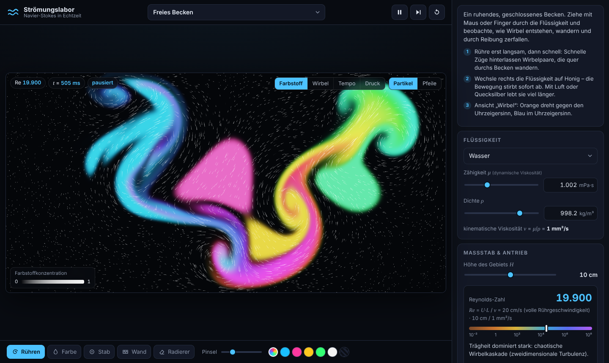

# Strömungslabor – Navier-Stokes im Browser

Eine interaktive Strömungssimulation als ganz normale Website: Flüssigkeit auswählen, mit Maus oder
Finger hindurchziehen und zusehen, wie Wirbel entstehen, wandern und durch Reibung zerfallen.

Dahinter steckt kein Grafikeffekt, sondern ein vollständiger Löser der **inkompressiblen
Navier-Stokes-Gleichungen** in echten SI-Einheiten, der direkt auf der Grafikkarte läuft (WebGL 2)
und gegen bekannte exakte Lösungen und Literatur-Benchmarks geprüft ist.



## Starten

Die Seite besteht nur aus statischen Dateien – kein Build-Schritt, keine Abhängigkeiten, kein Server nötig.

- **Als Website (GitHub Pages):** im Repository unter *Settings → Pages → Build and deployment*
  die Quelle „Deploy from a branch“ wählen, Branch und Ordner `/ (root)` einstellen, speichern.
  Nach etwa einer Minute ist die Seite unter `https://<benutzer>.github.io/<repository>/` erreichbar.
- **Lokal:** `index.html` per Doppelklick öffnen – oder im Projektordner `python3 -m http.server 8080`
  starten und `http://localhost:8080` aufrufen.

Benötigt wird ein aktueller Browser mit WebGL 2 (Chrome, Edge, Firefox, Safari ab 15). Beim Start misst die
Seite kurz die Leistung der Grafikkarte und wählt eine passende Gitterauflösung.

## Bedienung in Kürze

| Bereich | Funktion |
|---|---|
| Szenario (oben) | Freies Becken, Kármánsche Wirbelstraße, angestellte Platte, deckelgetriebene Kavität, Kelvin-Helmholtz-Instabilität, Freistrahl, Rayleigh-Bénard-Konvektion, Taylor-Green-Wirbel |
| Werkzeuge (unten) | **Rühren** (zieht die Flüssigkeit mit), **Farbe** (markiert, ohne zu stören), **Stab** (fester Rundstab am Cursor), **Wand** / **Radierer** (Hindernisse zeichnen), bei Konvektion **Heizen** / **Kühlen** |
| Ansicht (im Bild oben rechts) | Farbstoff, Wirbelstärke, Geschwindigkeitsbetrag, Druck, Temperatur; zuschaltbar: Partikel-Stromspuren und Geschwindigkeitspfeile |
| Flüssigkeit | Wasser, Luft, Honig, Glycerin, Öle, Quecksilber … oder **eigene Flüssigkeit** über Dichte ρ und Viskosität μ |
| Maßstab & Antrieb | Größe des Gebiets und Anström-/Deckelgeschwindigkeit in SI-Einheiten; daraus die Reynolds-Zahl mit Einordnung des Strömungsregimes |
| Messwerte | simulierte Zeit, Zeitschritt, kinetische Energie, Enstrophie, Restdivergenz, Widerstands-/Auftriebsbeiwert, Strouhal-Zahl, Sonde am Cursor; Export als CSV / PNG |

Tasten: Leertaste = Pause, `.` = Einzelschritt, `R` = Reset, `1`–`5` = Ansicht, `P` = Partikel, `V` = Pfeile.

## Was genau wird gerechnet?

```
ρ (∂u/∂t + (u·∇)u) = −∇p + μ ∇²u + f          Impulserhaltung
            ∇·u = 0                            Massenerhaltung (inkompressibel)
∂c/∂t + ∇·(u c) = D ∇²c                        Farbstoff (D = 0) und Temperatur
```

- **Newtonsches Fluid konstanter Dichte und Viskosität**, zweidimensional.
- **Echte Einheiten:** Gebietsgröße in Metern, Geschwindigkeiten in m/s, Stoffwerte ρ und μ der gewählten
  Flüssigkeit. Angezeigte Zeiten, Drücke (Pa), Energien (J pro Meter Tiefe) und Kräfte (N/m) sind physikalische Größen.
- **Keine künstliche Zähigkeit:** Die einzige Reibung im zentralen Schema ist die molekulare Viskosität ν = μ/ρ.
  Die Anzeige „aufgelöst (DNS)“ meldet, ob das Gitter die kleinsten Strukturen (∼ L/√Re) noch auflöst.
- **Cursor maßstabsgetreu:** Im freien Becken entspricht die Cursorbewegung der eines Rührstabs im gewählten
  Maßstab (eine Beckenhöhe pro Sekunde auf dem Bildschirm = H m/s).
- **Wärme (Szenario Rayleigh-Bénard):** Boussinesq-Näherung, Auftrieb g β (T − T₀), Temperaturleitfähigkeit κ.

### Numerisches Verfahren

| Baustein | Verfahren |
|---|---|
| Gitter | versetztes MAC-Gitter (Harlow & Welch 1965), quadratische Zellen; Geschwindigkeiten auf Zellflächen, Druck und Skalare in Zellmitten |
| Konvektion | finite Volumen in Divergenzform, zentrale Interpolation 2. Ordnung – erhält diskret Masse, Impuls und (reibungsfrei) kinetische Energie; optional bzw. automatisch lokal bei Zell-Péclet-Zahl > 2 QUICK-Aufwindkorrektur 3. Ordnung |
| Zeit | SSP-Runge-Kutta 3. Ordnung (Shu & Osher 1988), Projektion in jeder Stufe, adaptiver Zeitschritt (CFL ≤ 0,8) |
| Zähe Fluide | sobald die explizite Reibungsgrenze bindet (Zell-Reynolds-Zahl ≲ 1): inkrementelles Druckkorrekturverfahren mit Runge-Kutta-Tschebyschow-Stufen (stabilisiert explizit, 1. Ordnung in der Zeit, stationäre Zustände exakt) |
| Druck | exakte diskrete Projektion; Poisson-Gleichung per geometrischem Mehrgitter (V-Zyklen, Rot-Schwarz-Gauß-Seidel, exakte Lösung auf dem gröbsten Gitter über vorab invertierte Matrix) |
| Skalare | konservative Flussform, Aufwindverfahren 3. Ordnung mit Koren-Limiter (formerhaltend, keine Über-/Unterschwinger) |
| Ränder | Haft- und Gleitwände, bewegte Wand, periodisch, Einstrom (gleichförmig, Parabel, Strahl), konvektiver Ausstrom mit Massenstromkorrektur |
| Hindernisse | eingetauchte Ränder mit direkter Zwangskraft auf einer Volumenanteil-Maske (1. Ordnung an gekrümmten Konturen) |
| Genauigkeit | 32-Bit-Gleitkomma-Texturen; alle Löser-Zugriffe exakt per `texelFetch` (keine Texturfilterung) |

Intern rechnet der Löser dimensionslos in Gittereinheiten (Δx = 1, Geschwindigkeit in Einheiten der
Bezugsgeschwindigkeit U₀, Viskosität = 1/Zell-Reynolds-Zahl); `js/app.js` übersetzt in SI-Einheiten.

## Validierung

Die Tests laufen im echten Browser gegen denselben GPU-Code wie die Website (`node tests/validate.js`,
siehe unten). Stand der Ergebnisse (Software-Rendering SwiftShader, 32-Bit-Gleitkomma):

| Testfall | Prüfgröße | Ergebnis |
|---|---|---|
| Mehrgitter-Poisson-Löser | Residuenreduktion je V(1,1)-Zyklus, zufällige rechte Seite, alle Randtypen | Faktor 0,05 – 0,14; nach 6 Zyklen Rundungsniveau (10⁻⁶) |
| Projektion | max. Divergenz eines Zufallsfeldes nach 8 Zyklen | 1,8 → 3·10⁻⁷ |
| Taylor-Green-Wirbel (exakte Lösung) | kinetische Energie nach einer Halbwertszeit, N = 16 / 32 / 64 | Abweichung 0,89 % / 0,22 % / 0,058 % → **Ordnung 2,0 im Raum**; Zeitfehler < 3·10⁻⁵; Restdivergenz 6·10⁻⁸ |
| Poiseuille-Strömung | stationäres Parabelprofil, explizit und im steifen Modus (ν bis 200) | Fehler = h² (0,39 % bei 16, 0,098 % bei 32 Zellen) – exakt der erwartete Diskretisierungsfehler |
| Abklingende Scherwelle | Amplitude gegen exp(−νk²t) | RK3: 10⁻⁵; steifer Modus: 1. Ordnung in der Zeit |
| Deckelgetriebene Kavität, Re = 100, 64² | Geschwindigkeitsprofile auf den Mittellinien | max. Abweichung von Ghia et al. (1982): 0,004 (u), 0,009 (v). Extrema u_min = −0,2128, v_max = 0,1785, v_min = −0,2527 gegenüber hochgenauen Spektrallösungen (−0,2140 / 0,1796 / −0,2538, Botella & Peyret 1998): Abweichung ≤ 0,6 % |
| Zylinder im Kanal, Re = 100 (Schäfer & Turek 1996, Fall 2D-2) | c_W,max, c_A,max, Strouhal-Zahl | siehe `tests/cylinder.js` |

## Grenzen – was die Simulation nicht ist

- **Zweidimensional.** Echte Turbulenz ist dreidimensional (Wirbelstreckung, Energiekaskade zu kleinen Skalen).
  In 2D wandert Energie zu großen Wirbeln. Das Verhalten entspricht dünnen Schichten, Seifenfilmen oder
  stark geschichteten/rotierenden Strömungen – nicht einem turbulenten Wasserhahn.
- **Keine freie Oberfläche, keine Kompressibilität, kein Mehrphasenfluss.** Wellen, Spritzer, Schall und
  Tropfen kommen nicht vor; „Wasser“ meint das Innere einer vollständig gefüllten Kammer.
- **Auflösung ist endlich.** Bei großen Reynolds-Zahlen (z. B. Wasser im 1-m-Becken, Re ∼ 10⁶) sind die
  kleinsten Wirbel kleiner als das Gitter. Dann meldet die Seite „unteraufgelöst“; die QUICK-Korrektur
  wirkt als implizites Feinstrukturmodell – qualitativ plausibel, aber keine direkte numerische Simulation mehr.
- **Sehr zähe Fluide** werden mit einem Verfahren 1. Ordnung in der Zeit integriert; stationäre Zustände sind
  exakt, schnelle Einschwingvorgänge werden bei „Echtzeit“ nur grob aufgelöst (Zeitlupe wählen für mehr Genauigkeit).
- **Hindernisse** haben Treppenstufen-Genauigkeit (1. Ordnung); Kraftbeiwerte konvergieren entsprechend langsam.
- **Stoffwerte** sind Richtwerte bei 20 °C; reale Fluide wie Honig sind temperaturabhängig und teils nicht-newtonsch.
- **Echtzeit** hängt von der Grafikkarte ab. Reicht die Leistung nicht, läuft die Simulation ehrlich
  ausgewiesen in Zeitlupe weiter, statt die Physik zu verfälschen.

## Aufbau

```
index.html          Seite und Bedienelemente
css/style.css       Gestaltung
js/gl.js            WebGL-2-Hilfsschicht (Programme, Float-Texturen, Framebuffer)
js/shaders.js       GLSL-Quelltexte des Lösers (Randbedingungen, Konvektion, Mehrgitter, Diagnose)
js/solver.js        Zeitschrittverfahren, Projektion, Mehrgitter-Steuerung, Diagnose-Rückgabe
js/render.js        Feldansichten, Farbskalen, Partikel, Pfeile
js/fluids.js        Stoffdaten
js/scenarios.js     Szenarien (Ränder, Anfangsfelder, Hindernisse)
js/app.js           Oberfläche, Zeitsteuerung, Umrechnung Gitter ↔ SI
tests/              Validierung im Headless-Browser (Playwright)
```

## Tests ausführen

```bash
npm install            # installiert Playwright (nur für die Tests nötig)
npx playwright install chromium
npm test               # Schnelltests gegen analytische Lösungen (wenige Minuten)
node tests/cavity.js 100 64      # Kavität gegen Ghia et al.
node tests/cylinder.js 80 130    # Zylinder-Benchmark Schäfer & Turek (lang)
```

## Quellen

- F. H. Harlow, J. E. Welch: *Numerical calculation of time-dependent viscous incompressible flow of fluid with free surface*, Phys. Fluids 8 (1965).
- A. J. Chorin: *Numerical solution of the Navier-Stokes equations*, Math. Comp. 22 (1968).
- C.-W. Shu, S. Osher: *Efficient implementation of essentially non-oscillatory shock-capturing schemes*, J. Comput. Phys. 77 (1988).
- B. P. Leonard: *A stable and accurate convective modelling procedure based on quadratic upstream interpolation*, Comput. Methods Appl. Mech. Eng. 19 (1979).
- B. Koren: *A robust upwind discretization method for advection, diffusion and source terms*, in: Numerical Methods for Advection-Diffusion Problems (1993).
- P. J. van der Houwen, B. P. Sommeijer: *On the internal stability of explicit m-stage Runge-Kutta methods for large m-values*, ZAMM 60 (1980).
- E. A. Fadlun, R. Verzicco, P. Orlandi, J. Mohd-Yusof: *Combined immersed-boundary finite-difference methods for three-dimensional complex flow simulations*, J. Comput. Phys. 161 (2000).
- U. Ghia, K. N. Ghia, C. T. Shin: *High-Re solutions for incompressible flow using the Navier-Stokes equations and a multigrid method*, J. Comput. Phys. 48 (1982).
- O. Botella, R. Peyret: *Benchmark spectral results on the lid-driven cavity flow*, Comput. Fluids 27 (1998).
- M. Schäfer, S. Turek: *Benchmark computations of laminar flow around a cylinder*, in: Flow Simulation with High-Performance Computers II, Vieweg (1996), S. 547–566.

Lizenz: MIT (siehe `LICENSE`).
